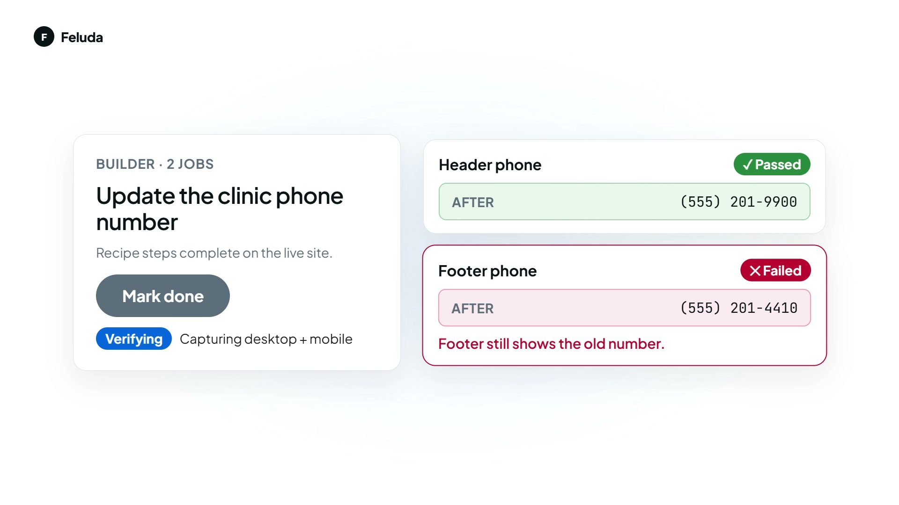
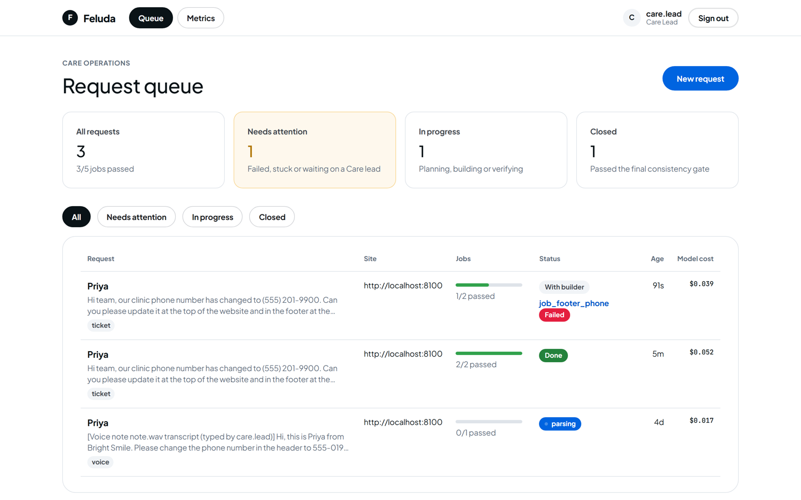
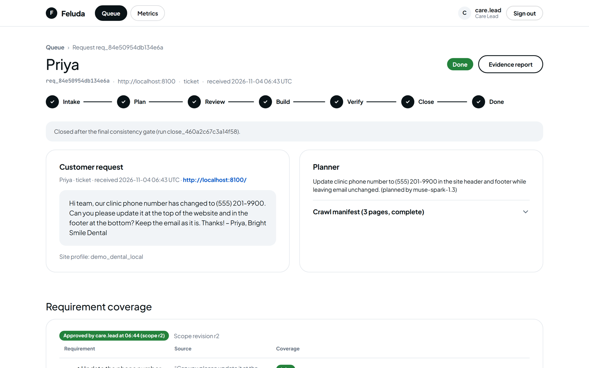
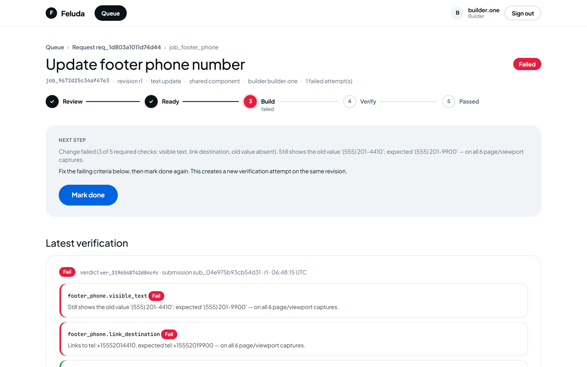
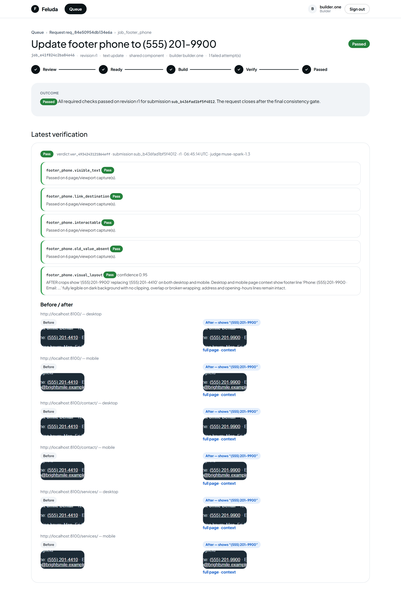
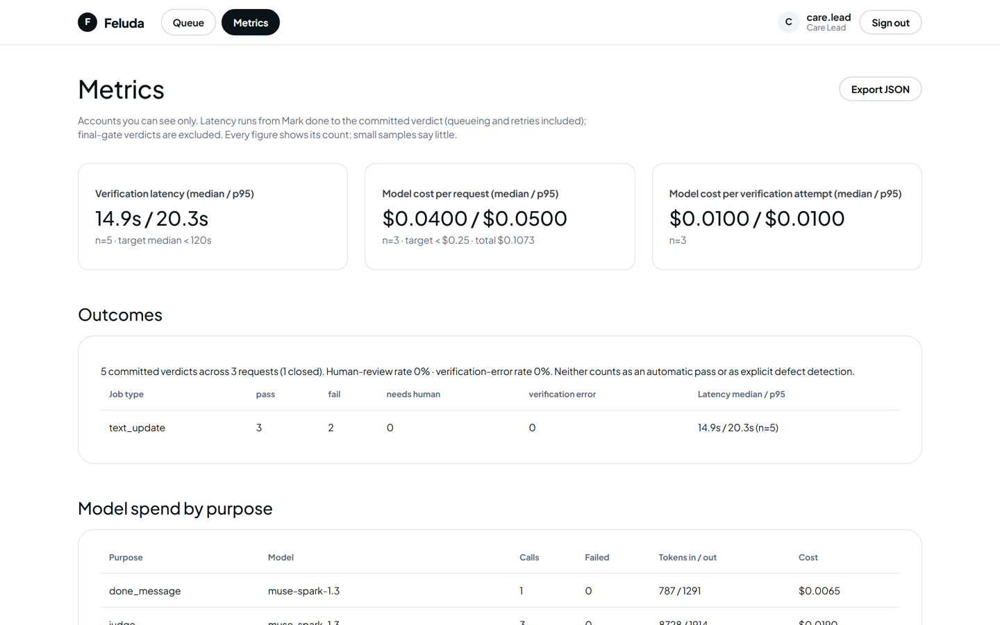
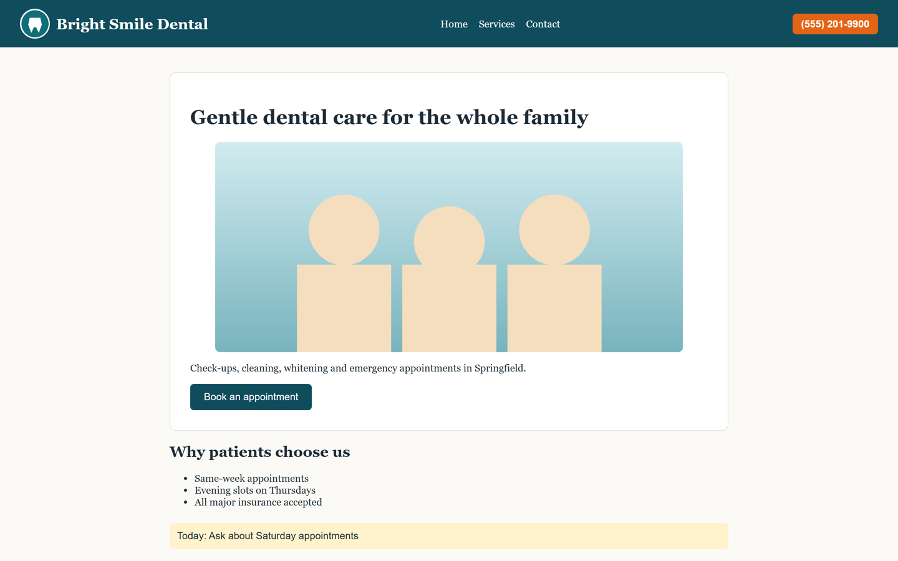

# Feluda Care Agent

Turns a customer's website change request into atomic jobs, step-by-step
builder instructions and an AI-verified "done" — built on Meta models.
Design: `Feluda Care Agent — Product & Technical Spec.md`.

## Hackathon submission

| | |
| --- | --- |
| Event | Meta Global AI Developer Hackathon (Oct 26 – Nov 4, 2026) · theme "Build for Your World" |
| Track | **Indie** (solo) |
| Builder | [naren0207](https://github.com/naren0207) |
| Demo video | [docs/feluda-demo.mp4](docs/feluda-demo.mp4) (25 s, narrated) |

[](docs/feluda-demo.mp4)

**The problem.** Website-care teams handle a steady stream of small change requests ("our
phone number changed, please update the header and footer"). The builder says *done*, the
customer finds the footer still shows the old number, and trust erodes. Checking every page at
every viewport by hand doesn't scale, so nobody does it.

**What Feluda does.** It turns the customer's message into precise, atomic jobs (one per place
the change must land), gives the builder validated step-by-step recipes, and when the builder
clicks **Mark done** it checks the live site itself: Playwright captures at desktop and mobile,
deterministic DOM checks, SAM 3.1 element localisation, and a Muse Spark visual judge. A request
closes only when every job passes and a final consistency gate re-checks the whole site; then
Muse Spark drafts the "done" note for a human to send.

**The demo moment.** A builder fixes the header, forgets the footer, and marks both done.
Feluda passes the header, fails the footer with the exact reason ("Still shows the old value
'(555) 201-4410'; expected '(555) 201-9900' — on all 6 page/viewport captures"), and blocks
closure until it's fixed. Run it yourself with `python -m scripts.live_demo` (see Quick start).

**Measured on the live demo (2026-11-04, real Meta API):** one request = 8 model calls,
≈ $0.05 in model spend (spec target < $0.25); verification latency from Mark done to verdict
14.9 s median / 18.6 s p95 (target median < 2 min), n = 3. These are small demo samples, not a
production benchmark. The test suite (`python -m pytest`, unit rules plus end-to-end browser
runs with scripted models) passes 76/76.

### Screenshots

| | |
| --- | --- |
|  **Request queue** — every request with job progress, status and model cost. |  **Request** — customer text, Muse Spark plan, requirement-coverage approval. |
|  **Failed verdict** — the forgotten footer, with per-check reasons and a re-submit path. |  **Passed verdict** — per-check results, judge confidence and before/after crops for 3 pages × 2 viewports. |
|  **Metrics** — latency, outcome rates and model spend by purpose. |  **Demo site** — the bundled local WordPress stand-in (Bright Smile Dental, fictional data). |

### Where to look

- **Meta models used and how:** [Meta models used](#meta-models-used) (Muse Spark 1.3 / 1.1, Muse Wonder, SAM 3.1, Muse Image, Muse Voice Transcribe).
- **Why a pass can be trusted:** [What it verifies](#what-it-verifies) and the [verification eval](#verification-eval-release-gate), which fails the build on any false pass.
- **What isn't proven yet:** [Prototype limits](#prototype-limits-honest-scope). Recipes have been validated only on the bundled demo site, and the 30-request labelled planner eval needs real anonymised requests.

```
Intake (dashboard, email/ticket webhooks, IMAP, voice notes) ─► Planner (Muse Spark 1.3) ─► Care lead coverage review ─► baseline capture (DOM + SAM 3.1)
      ─► Builder card (validated recipe steps) ─► Mark done ─► durable task queue
      ─► Worker: Playwright capture ─► deterministic checks ─► visual judge (Spark 1.3 → 1.1, Wonder escalation)
      ─► pass / fail / needs_human / verification_error ─► final consistency gate ─► drafted done note
```

## Quick start (local demo)

```bash
pip install -r requirements.txt
python -m playwright install chromium
cp .env.example .env          # then set MODEL_API_KEY
```

Create the demo logins (random passwords are written to `var/dev_users.txt`,
which is gitignored) and the demo site's form-test account:

```bash
python -m feluda.users seed-dev
```

Start the bundled demo WordPress site and the dashboard (two terminals):

```bash
python -m uvicorn demo_site.app:app --port 8100
```

```bash
python -m uvicorn feluda.web:app --port 8000
```

Open http://localhost:8000 and sign in as `care.lead`, paste a request for
`http://localhost:8100/` (e.g. *"Our phone changed to (555) 201-9900 — update
the header and footer"*), approve the coverage map, then sign in as a builder
to start jobs. Make (or deliberately botch) the change in the demo site's
simulated admin at http://localhost:8100/wp-admin/ and select **Mark done**.
Add real users with `python -m feluda.users add NAME care_lead|builder --accounts acct_a,acct_b`.

The whole three-minute demo script can also run headless against live models:

```bash
python -m scripts.live_demo
```

It plans the request, captures baselines, passes a correct header change,
fails a forgotten footer, blocks closure, re-verifies the fix and closes via
the final consistency gate, printing per-model call counts and cost.

The new change types, voice and image drafts have their own live run:

```bash
python -m scripts.live_features [path/to/voice-note.wav]
```

## What it verifies

| Change type | Verified by |
| --- | --- |
| Text / phone / email (`text_update`) | Exact element text = baseline text with only the old value replaced; old value gone from the region; `tel:`/`mailto:` target; clickable; visual judge |
| Button / link (`link_button_change`) | Label, normalised destination (redirects followed through the network guard), clickability; visual judge |
| Image / logo (`image_swap`, `logo_change`) | Approved visual match: structure (dHash) **and** colour fingerprint of the rendered image vs the approved image (customer attachment, upload, or an approved Muse Image draft), not file names; not the original; loads, undistorted, fits the viewport; judge sees the approved image as reference |
| Menu (`menu_change`) | Rename/relink or add an item; full label order when specified; on mobile the collapsed menu is opened with its toggle before checking visibility and clickability |
| Contact form (`form_check`) | Approved sites only, existing test account from the secrets store, one correlated submission per attempt (recorded as *submitting* before the click), success feedback, matching message in the test inbox (demo inbox or IMAP); unresolved submissions are settled by reading the inbox, never resubmitted |

## Intake

- **Dashboard** form: text, screenshots, voice notes.
- **Webhooks** (header `X-Feluda-Intake-Token: $FELUDA_INTAKE_TOKEN`):
  `POST /intake/email` with JSON `{from, subject, text, site_url?, attachments:[{filename, content_type, data_b64}]}`
  or a raw `message/rfc822` body, and `POST /intake/ticket` with `{site_url, text, customer?, attachments?}`.
  The website URL is required: taken from the payload, a URL in the message, or the
  sender's customer account (`email_domains`); otherwise the webhook answers 422.
- **IMAP** support mailbox: `python -m feluda.intake imap --every 60`.
- **Voice notes** are transcribed with Muse Voice Transcribe before planning. If the
  endpoint is unavailable (see below) the request waits in *awaiting transcript* and a
  Care lead types the transcript on the request page.

## Access, privacy and retention

- Sign-in with salted PBKDF2 password hashes and signed, expiring session cookies; same-origin
  check on every POST (CSRF). Users see only their customer accounts (`"*"` = all); other
  accounts' requests, jobs and evidence are "not found", including signed evidence links.
- Model prompts are stripped of credentials, card numbers and government IDs (phone numbers and
  emails stay, since they are usually the change itself). Logs, stored task errors and model-call
  errors additionally mask emails and phone numbers.
- Evidence files, attachments and image drafts are deleted after `FELUDA_RETENTION_DAYS`
  (default 90) from closure or last activity; metadata and verdicts are kept with `purged_at`.
  Runs daily in the worker, or `python -m feluda.retention --dry-run`.
- `/metrics` (Care lead): verification latency median/p95 by job type and result, pass / fail /
  human-review / verification-error rates, and model cost per request and per attempt by purpose.

## Meta models used

Verified by direct API probes on 2026-10-30 (`/v1/models`, Messages and
Responses endpoints):

| Stage | Model | Notes from probes |
| --- | --- | --- |
| Request parsing, job planning | `muse-spark-1.3` | Tool calling works with `tool_choice: auto` only (named/any rejected), so structured output asks for one tool call and falls back to JSON in text, with one repair retry |
| Visual judge | `muse-spark-1.3`, fallback `muse-spark-1.1` | Both accept base64 image input via Messages |
| Escalation (invalid plan, ambiguous visual result, repeated failure) | `muse-wonder-1.0` | Capped per job |
| Element localisation | `sam-3.1` | Only via `/v1/responses` (`input_image` + `input_text`); returns `<\|box;x1..y2;w;h\|>` + RLE mask. Grounds visual phrases ("orange button") but returned nothing for semantic phrases or small plain-text links, so it supplements the DOM only for visually distinct elements |
| Done-message draft | `muse-spark-1.3` | Human sends it |
| Replacement-image drafts | `muse-image-1.0` | `/v1/images/generations` returns base64 WebP; a Care lead must approve a draft before builders use it |
| Voice-note transcription | `muse-voice-transcribe-1.0` | Listed by `/v1/models`, but on this API key every audio route (`/v1/audio/transcriptions`, `/v1/responses`, chat) returned 404 on 2026-10-31. The client targets `/v1/audio/transcriptions` and falls back to a typed transcript until Meta enables it |

Contributor-tier models are refused in code for any call. Every call is logged
with request, job revision, model, prompt version, tokens, latency and an
estimated cost; a per-request spending cap (`FELUDA_REQUEST_COST_CAP_USD`)
routes work to review when reached. A live demo run (2 jobs, one failed
attempt, final gate) cost ≈ $0.11 in model spend.

## Configuration

See `.env.example`. Notes:

- `FELUDA_MODEL_BASE_URL` wins over `ANTHROPIC_BASE_URL`; processes started
  inside Claude Code inherit its `ANTHROPIC_BASE_URL`, which would otherwise
  override the Meta endpoint.
- `FELUDA_APPROVED_TEST_ORIGINS` lists private origins the crawler and browser
  may visit (the demo site). Everything else must resolve to public addresses;
  loopback, private, link-local and metadata addresses are blocked for pages
  and browser subrequests.
- SQLite is the default; set `DATABASE_URL` to Postgres (`docker compose up -d`)
  for multiple workers (claims use `FOR UPDATE SKIP LOCKED`).
- `FELUDA_INLINE_WORKER=1` runs the worker in a thread of the web process; set
  it to 0 and run `python -m feluda.tasks` for a separate worker.

## Code map

| Module | Role |
| --- | --- |
| `feluda/planner.py`, `sitefetch.py` | Read-only crawl + grounded outline; Spark 1.3 plan |
| `feluda/jobspec.py`, `profiles.py` | Locators, acceptance checks, recipe snapshots (no model-written navigation) |
| `feluda/capture.py` | Playwright capture, landmark-scoped unique target resolution, crops, region text |
| `feluda/checks.py` | Deterministic checks, freshness, regression scan, pass rule |
| `feluda/judge.py`, `sam.py` | Visual judge with fallback/escalation; SAM 3.1 client |
| `feluda/pipeline.py` | Task handlers: plan, baseline, verify, final consistency gate, done note |
| `feluda/service.py`, `states.py` | Application rules: roles, transitions, revisions, coverage approval, leases |
| `feluda/tasks.py` | Durable DB queue: idempotency keys, leases, bounded retries, dead handlers |
| `feluda/web.py`, `templates/` | Queue, builder job card, evidence report |
| `demo_site/` | Local stand-in for an approved WordPress test site with a simulated wp-admin |
| `feluda/fixtures/site_profiles/` | Site profiles and validated, hashed recipes |

## Tests

```bash
python -m pytest            # unit rules + end-to-end loop (Playwright, scripted models; ~2 min)
python -m scripts.smoke_test
```

The end-to-end tests drive real browser captures against the demo site with
a scripted model gateway: forgotten footer fails and blocks closure;
duplicate clicks reuse one attempt; a corrected resubmission on the same
revision creates a new attempt; stale verdicts cannot commit; an edit after
verification is caught by the final gate; an unmapped requirement blocks approval.

## Verification eval (release gate)

```bash
python -m scripts.eval_verify            # live Spark 1.3 judge + SAM
python -m scripts.eval_verify --offline  # deterministic layer only, no API spend
```

Paired correct/planted-error states on the demo site: correct change, typo,
extra digit, old `tel:` link, old text, omitted change, unrelated footer and
button edits (regressions) and a stale page cache. Exits non-zero on any
false pass; review outcomes are reported separately from explicit failures.

## Prototype limits (honest scope)

- The demo site is a local simulation of WordPress; recipes for real sites
  must be validated on each site before jobs can become ready (the bundled
  `example_dental_blocktheme` profile shows a blocked, unvalidated recipe).
- Supported job types: text, link/button, image/logo, menu (rename, relink, add, reorder) and
  contact-form delivery. Removing content and other types route to a human.
- Sequential captures cannot prove an atomic snapshot; the edit freeze
  coordinates tool users only. Evidence states the verification interval.
- The IMAP connectors (test inbox and support mailbox) are implemented but only the demo
  inbox has been exercised end to end; a real mailbox needs credentials in the secrets store.
- Browser DNS is checked per request but not pinned at connection time;
  production capture should sit behind an egress proxy enforcing the policy.
